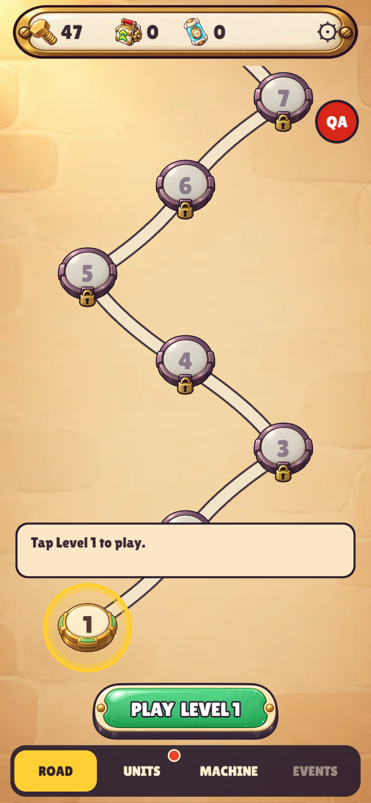
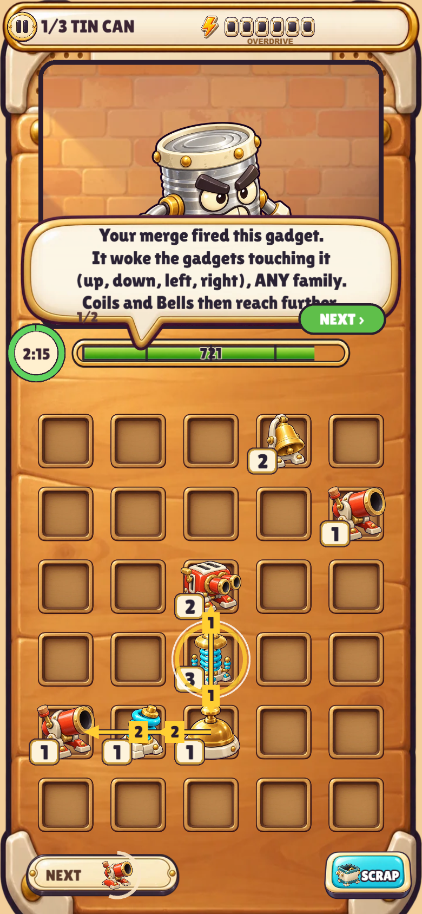
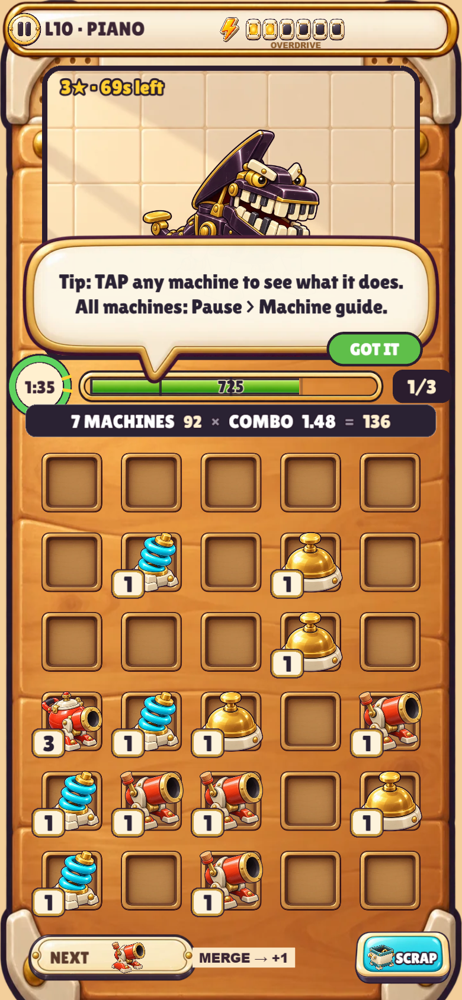
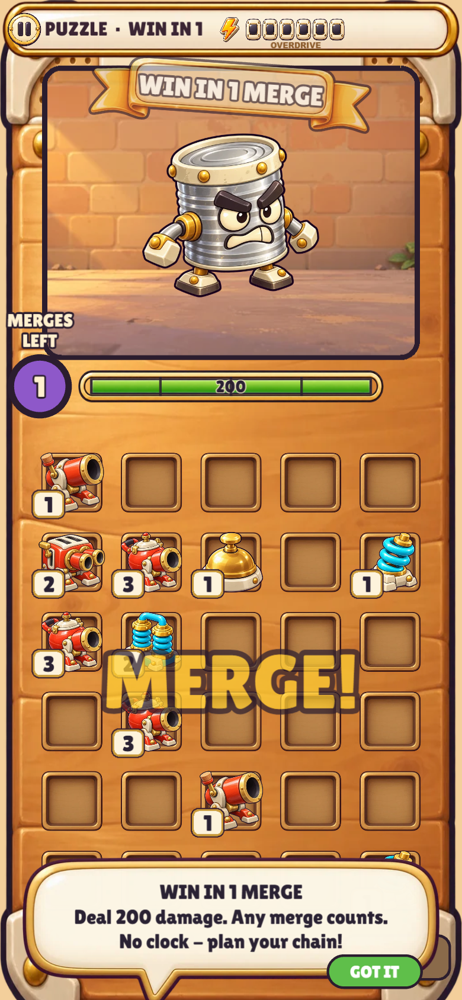
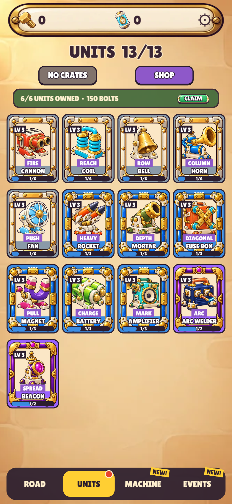
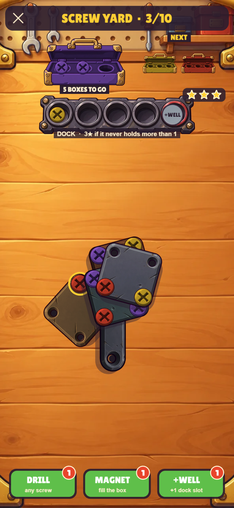

# One More Merge

A phone merge-chain game in a junk workshop. Drag two identical gadgets together and they merge into one gadget of the next rank. The new gadget fires, and it wakes the gadgets touching it. Those fire too, and pass the spark along, so one merge can run a whole chain of cannons, coils and bells into a junk machine or a boss. Every unit has a job (shooter, relay or support), crates hand out new units, and besides the 80-level saga there are Workshop puzzles, a daily, bounties and a Screw Yard sorting mode.

Portrait, one finger, runs in the browser. Add it to your home screen and it behaves like an app.

## Contents

- [Play](#play)
- [Screenshots](#screenshots)
- [Game guide](#game-guide)
- [Tech](#tech)
- [Quick start](#quick-start)
- [Project layout](#project-layout)
- [How levels and balance are made](#how-levels-and-balance-are-made)
- [Feature flags and QA](#feature-flags-and-qa)
- [Docs](#docs)
- [Contributing](#contributing)
- [License](#license)

## Play

**https://idoggk.github.io/one-more-merge/**

Open it on your phone. On iPhone: Safari > Share > Add to Home Screen. It also works in a desktop browser (use a narrow window).

- **Settings > build label.** The Settings screen shows a line like `Build 2026-10-10 10:30 · 54b2585` (date, time, short git commit) and a RELOAD LATEST link. Use it to check which build your phone runs. RELOAD LATEST clears caches and reloads; your save is not touched.
- **QA tools are for testing.** The red `QA` button on the road and `QA TOOLS` in Settings open a panel of switches for unfinished features and shortcuts. Using them can change or confuse your save, so leave them alone if you just want to play.
- URL flags: `?reset` wipes the save and starts fresh. `?playtest=1` is a simplified test build (see [PLAYTEST.md](PLAYTEST.md)).

## Screenshots

Phone size (390x844), taken with headless Chrome by `tools/shots.mjs`.

| Road | Chain explainer | Boss level |
|---|---|---|
|  |  |  |

| Workshop puzzle | Units | Screw Yard |
|---|---|---|
|  |  |  |

The Units shot shows the shipped collection of 13 units. The new units are still behind switches (see [Feature flags and QA](#feature-flags-and-qa)).

## Game guide

### The board and ranks

- The board is **5 columns x 6 rows**. Gadgets are placed on it; the next gadget arrives on a timer and shows in the NEXT slot.
- **Drag a gadget onto an identical one** (same family, same rank) to merge. A merge frees one cell, keeps the family, and raises the rank. Ranks go 1 to 8.
- Moving or swapping gadgets never deals damage. Only merges and the chains they start do.
- **SCRAP** removes a gadget you do not want.
- Every level has a clock and a machine (or boss) to beat; levels can also ask for a goal such as a chain of a given length.

### Chains

- The merged gadget **fires** and **wakes the gadgets touching it** (up, down, left, right), any family.
- A woken gadget fires, then does its own job: a shooter hits the target, a relay wakes more gadgets, a support card does something else (see below).
- Each gadget fires **at most once per cascade**, so chains always end.
- Chain length feeds a combo multiplier, and a full Overdrive bar boosts damage. Tap any gadget in play to see exactly what it does.

### Units

Units come in three types: **Shooter** (hits the target), **Relay** (passes the chain on to other gadgets) and **Support** (a helper card you tap). Each unit has one clear job, and levels 3 / 6 / 9 of a unit change how its job works, not just its numbers. Rarities are Common, Rare, Epic and Legendary. The full rules, upgrade lines and caps are in [docs/ROSTER.md](docs/ROSTER.md).

**In the shipped game today (13 units):** Cannon, Coil, Bell, Horn, Fan (Common); Rocket, Mortar, Fuse Box, Magnet, Battery, Amplifier (Rare); Arc Welder, Signal Beacon (Epic).

**Built behind switches, off by default (26 more, 39 in total):**

| Rarity | Units |
|---|---|
| Common | Nail Gun, Wrench, Piston, Spring, Rivet Gun, Vice |
| Rare | Jackhammer, Gear, Blowtorch, Pipe, Blast Plate, Router |
| Epic | Saw Blade, Belt Drive, Capacitor, Blueprint, Ladder, Rewind Crank, Wrecking Ball, Hydraulic Press, Lathe |
| Legendary | Tesla Tower, Crane, Dynamo, Robot Arm, Tilt Lever |

With the crate redesign switched on, Signal Beacon moves from Epic to Legendary. The table lists units by their rarity in the roster design. The source of truth is `src/content/units.ts`.

### Crates

Crates drop from level rewards and bosses, and hold unit cards (duplicates level a unit up). Today's crates are Wood, Iron and Gold. The odds of each crate are shown in-game on the crate odds panel, so they are not repeated here. The toolbox-themed redesign (Tool Bag, Toolbox, Tool Chest, Golden Workbench) is behind a switch; its design is in [docs/ROSTER.md](docs/ROSTER.md) section 5. Premium and Gem purchases are a mock: there are no real payments.

### Modes

- **Saga levels:** 80 levels in 8 chapters of 10, with monsters, mini-bosses and chapter bosses, 1 to 3 stars each, and perks between phases.
- **Workshop puzzles and drills:** "win in N merges" boards with no clock, like chess puzzles. Every unit has drills that teach its job.
- **Daily:** one puzzle per day.
- **Bounties:** bounty boards with their own targets and rewards.
- **Screw Yard:** a separate sorting mode. Unscrew plates, drop the screws in the matching coloured boxes, and keep the dock from overflowing. Boosters (Drill, Magnet, +Well) help, and the yards ramp up in difficulty.

More modes exist (Endless, Boss Rush, Remix, seasons); their rules are in [DESIGN.md](DESIGN.md).

## Tech

- TypeScript `^5.9.3`
- [Phaser](https://phaser.io/) `^3.90.0` for rendering and input
- [Vite](https://vitejs.dev/) `^6.4.3` for dev server and build
- [Vitest](https://vitest.dev/) `^3.2.7` for tests
- `@fontsource/lilita-one` for the font, `puppeteer-core` and `sharp` for screenshot and art tools

The game model (`src/core`) is pure and deterministic. Seed plus actions always gives the same state, and all randomness comes from saved seeded random streams. Phaser only draws.

## Quick start

You need Node.js and npm. The repo ships a lockfile, so use `npm ci`.

```
git clone https://github.com/idoggk/one-more-merge.git
cd one-more-merge
npm ci
npm run dev          # Vite dev server on http://localhost:5173 (also on your LAN)
npm test             # Vitest
npm run typecheck    # tsc --noEmit
npm run build        # typecheck + production build into dist/
```

On a phone on the same Wi-Fi, open `http://<your PC's IP>:5173`.

Deploy: `npm run deploy` builds, then force-pushes `dist/` to the `gh-pages` branch, which GitHub Pages serves at the live link. Only the owner does this.

Other scripts: `npm run sim` (balance bots), `npm run shots` (phone screenshots of named states), `npm run test:touch`, `npm run artifact` (single-file build for claude.ai).

## Project layout

```
src/
  core/      pure, deterministic game model (no Phaser): game.ts (state, commands, 50 ms tick),
             cascade.ts (bounded chain resolver), rng.ts, crates, economy, bosses, puzzles,
             Screw Yard solver and generator, and roster1..7.ts (rules of the new unit batches)
  content/   data and tuning: tuning.ts (balance constants and feature flags), units.ts,
             levels.json (generated), puzzles.json, yards.json, perks and copy text
  game/      Phaser presentation: GameScene (turns model events into animation), ScrewScene,
             ObjectYardScene, textures, audio, per-batch art; sprites never hold game state
    ui/      GameScene's menus as fn(scene, ...) modules: QA panel, HUD, results, settings,
             pause, and the road / units / machine / events tabs
    fx/      small animation helpers (shake, chain ladder, toolbox crates)
  platform/  save backup, storage warnings, telemetry
  assets/art/ PNG art; a missing key falls back to a procedural drawing
tools/       balance bots, level/puzzle/yard generators, reports, art import, screenshots, deploy
tests/       Vitest suites (engine invariants, units, crates, levels, puzzles, QA panel, saves)
docs/        ROSTER.md and the round specs (ROUND*.md); docs/readme/ holds the README screenshots
DESIGN.md    rules and the decisions log
```

## How levels and balance are made

Balance numbers live in `src/content/tuning.ts`: change them there first. Level data is **generated by tools and must not be hand-edited**:

| File | Written by |
|---|---|
| `src/content/levels.json` (80 levels: HP, clocks, goals) | `tools/sim-levels.ts` (HP calibration), `tools/fit-goals.ts` (chain goals), `tools/star-times.ts` (star lines) |
| `src/content/puzzles.json` (Workshop drills and daily puzzles) | `tools/gen-puzzles.ts` (curve check: `tools/puzzle-curve.ts`) |
| `src/content/yards.json` (Screw Yard weekly ramp) | `tools/gen-yards.ts` |
| `src/content/dailySeeds.ts` | `tools/daily-seeds.ts` |

Run TypeScript tools with `npx vite-node tools/<name>.ts` (each file's header comment lists its options). Read-only studies: `tools/sim.ts` (balance bots on the real engine), `tools/level-report.ts` (per-level bot results), `tools/chaos-sim.ts`, `tools/squad-swap.ts`, `tools/think-bank.ts`, `tools/boss-audit.ts`.

## Feature flags and QA

New features ship behind **`TUNING` flags** in `src/content/tuning.ts`, default OFF, so the live game stays unchanged until the owner decides. Examples: `roster1`..`roster7` (the unit batches), `rosterB` (toolbox crates and Legendary), `rosterUnlocks` (chapter unlock plan), `thinkBank`, `unitsB0` / `unitsB1`.

The **QA panel** flips these flags without a rebuild:

- Open it with the red `QA` button on the road or `QA TOOLS` in Settings.
- **ALL NEW UNITS** turns on crates B plus unit batches 1 to 7 in one tap (ON / OFF / MIXED); individual batch switches still work afterwards. The **UNLOCK PLAN** row adds the gifts and crate tiers.
- Add a switch by adding one `qaSwitch({...})` entry to `QA_ROWS` in `src/game/ui/qaPanel.ts`.

There is no separate QA guide document yet.

## Docs

- [DESIGN.md](DESIGN.md): rules, the decisions log and balance sims
- [docs/ROSTER.md](docs/ROSTER.md): every unit, rarity, crate odds design, unlock plan, open questions
- `docs/ROUND*.md`: older specs (first 20 levels, items, mini-bosses, cast and stages, Boss Rush, chapters 7-8)
- [PLAYTEST.md](PLAYTEST.md): the playtest kit
- [CLAUDE.md](CLAUDE.md): short architecture notes and invariants

## Contributing

- `npm test` and `npm run typecheck` must pass before you commit.
- New features go **behind a `TUNING` flag, default OFF**, with a QA switch and tests.
- Keep `src/core` free of Phaser. Add menus and UI under `src/game/ui/`, not in `GameScene.ts`.
- Invariants (tested in `tests/core.test.ts`): a merge frees one cell and keeps rank mass and family; move and swap never deal damage; each gadget fires at most once per cascade; seed plus actions gives identical state; previews never change state; animations never pause the simulation.
- Do not hand-edit generated JSON; rerun the tool.
- **No real payments.** The premium lane and Gem packs are mocks. Do not add a store SDK or any payment code.
- Art: drop PNGs into `src/assets/art/<key>.png`; see `tools/import-art.mjs`. Missing art falls back to procedural drawings.

## License

License: not chosen yet.
