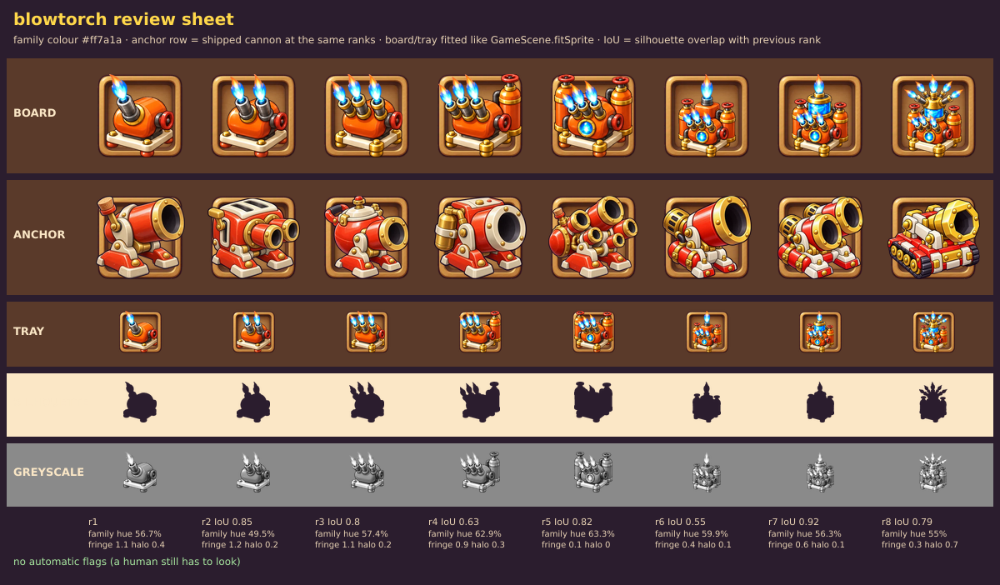

# Review: Blowtorch ladder, GPT sheet v1 (first pass with the v3 template)

Sheet: `../inbox/blowtorch_sheet_v1.png` · sliced: `../inbox/blowtorch_v1/` · review sheet: `blowtorch_v1_review_sheet.png`

## Verdict: **7.7 / 10 on the first try.** Best sheet so far. Short of 8, one cheap targeted round recommended.

| Sheet | Round | Absolute |
|---|---|---|
| Piston v1 | 1 (old template) | 6.5 |
| Piston v3 | 3 (old template, wording tuned) | 7.2 |
| **Blowtorch v1** | **1 (new template)** | **7.7** |

The new template (polish language, size rule, part budget, counted axis, splay) did what the Piston rounds could not: a good first pass. Under a tiered bar (7.5 for Common and Rare) this unit would pass; under the strict 8 it is 0.3 short.

## What is strong
- **Identity**: unmistakably a blowtorch, charming, distinct from Cannon (orange, tanks, flames).
- **Ladder**: counted flames (1, 2, 3), then a side tank, a second tank with a gauge, a stacked tier, a crystal tank, a crown of five flames. Overlap with the previous rank 0.85, 0.80, 0.63, 0.82, 0.55, 0.92, 0.79: the outline changes at almost every step, and flames make it sprout, as asked.
- **Finish**: bold outline, one big highlight per part, no scratches or engraved lines; the finish we wanted from the polish test, now on the first pass. Flame edges are clean on the dark slot (zoom checked), halo 0 to 0.7%.
- **Colour**: orange body dominant at every rank (family-hue pixels 50-63% of the object), blue flames as a complementary accent, gold restrained.
- **Rank 8** (five flames fanning from a gold crown manifold) is the first top rank that looks like a hero.

## Scores

| Dimension | Weight | Score | Why |
|---|---|---|---|
| Silhouette and readability | 25% | **7.5** | Distinct and spiky; but ranks 6 and 7 share one outline (0.92), and ranks 6-8 shrink to a small cluster at tray size. |
| Material and light | 20% | **8.0** | Clean glossy enamel, convincing crystal, well-painted flames. |
| Style match | 15% | **8.0** | Bold outline, chunky, rounded; close to the anchors. |
| Colour | 10% | **8.0** | |
| Rank progression | 20% | **7.5** | Additive and counted, but rank 6 reshuffles sizes (tanks and flames get smaller than at rank 5). |
| Technical | 10% | **9.0** | |
| **Weighted** | | **7.9, minus 0.2 for part budget and plate size = 7.7** | |

Per rank: r1 7.5 · r2 7.5 · r3 8.0 · r4 8.0 · r5 7.5 · r6 7.5 · r7 7.5 · r8 8.0.

## The 5 worst flaws
1. **Ranks 6 and 7 look the same in outline** (0.92): the crystal tank replaces the orange tank at the same size, a material change only.
2. **Rank 6 is not rank 5 plus one thing**: the side tanks and flames shrink.
3. **Over the 12-part budget from rank 5** (rank 8 has about 25 parts). At 62 px ranks 6-8 are a small busy cluster.
4. **The plate and gold bun feet are wider than the machine at ranks 1-4**, so the machine looks small on it.
5. **Integration problem, not an art flaw: baked flames.** They are part of the silhouette (good), but the game draws its own flame cone when the Blowtorch shoots, and the nozzle positions move with every rank, so the code effect would need per-rank nozzle origins. Decision needed (see below).

## Fixes (round 2 template changes, now in `../prompts/00_style_block.md` v4)
- A rank whose change is a material swap must also change the outline (make the new part taller or wider than what it replaces).
- Every earlier part keeps its size in later ranks.
- The plate is at most 15% wider than the machine.

Round 2 prompt, only 3 changes: `../prompts/06_blowtorch_v2.md`.

## Decision for integration (owner)
Keep the baked flames as permanent pilot-light flames? **Recommended: yes**, they are what makes the outline change per rank, and the code attack flame starts from per-rank nozzle points (a small table). The alternative is flame-free art, which loses the strongest silhouette device.
