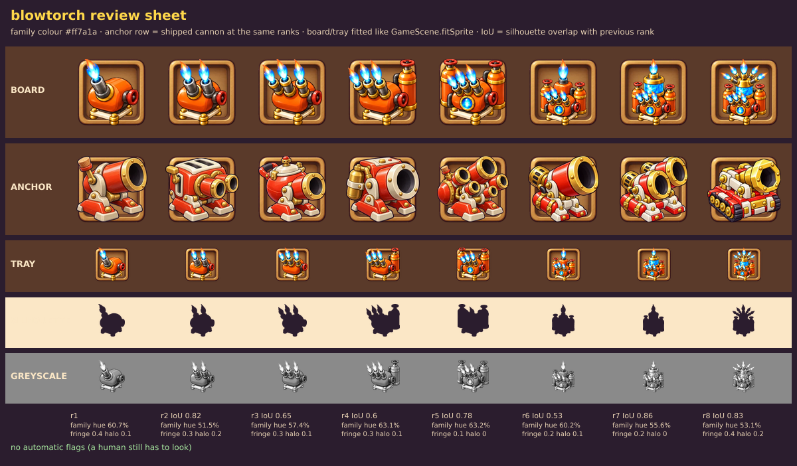

# Review: Blowtorch ladder, GPT sheet v2 (round 2, 3 targeted fixes)

Sheet: `../inbox/blowtorch_sheet_v2.png` · sliced: `../inbox/blowtorch_v2/` · review sheet: `blowtorch_v2_review_sheet.png`

## Verdict: **7.8 / 10** (v1 was 7.7). Ships under a 7.5 bar for Common and Rare; 0.2 short of a strict 8.

## The three fixes
| Fix | Result |
|---|---|
| 1. Ranks 6 and 7 need different outlines | **Done.** The crystal tank is now wider than the orange tank it replaces; overlap 0.92 to **0.86**. (It is wider, not taller.) |
| 2. Earlier parts keep their size in ranks 6-8 | **Not done.** The side tanks and front flames are still clearly smaller in ranks 6-8 than in rank 5, as in v1. The Piston sheet showed the same jump at ranks 5 to 6 in three rounds. This is a **model limit** (it does not hold proportions across a rank step on a sheet), not a wording problem: stop asking. |
| 3. Smaller plate | **Done.** The plate is narrower and the machine fills the cell better (rank 1 now overlaps the old rank 1 by only 0.82 because the outline changed). Side effect: the four gold bun feet now look big against the thin plate. |

Colour (family-hue pixels 51-63%), halo (0 to 0.2%), flame edges: all still good. Ladder overlaps with the previous rank: 0.82, 0.65, 0.60, 0.78, 0.53, 0.86, 0.83.

## Scores
Silhouette 7.8 · Material 8.0 · Style 8.0 · Colour 8.0 · Progression 7.5 · Technical 9.0 → weighted 7.95, minus 0.2 for the part budget and the shrinking tanks = **7.8**.
Per rank: r1 8.0 · r2 7.5 · r3 8.0 · r4 8.0 · r5 7.5 · r6 7.5 · r7 8.0 · r8 8.0.

## The 5 worst flaws
1. **Ranks 6-8 shrink the tanks and flames from rank 5** (not fixed in two rounds).
2. **Over the 12-part budget at ranks 5-8**; small busy cluster at 62 px.
3. **Gold bun feet look oversized** against the thinner plate.
4. **Crystal tank is wider but not taller**, so ranks 6 and 7 are still the closest pair (0.86).
5. **Integration**: baked flames vs the code attack flame, nozzle positions change per rank (decision still open).

## What to do with it
- **Blowtorch v2 is the candidate for the game** at the tiered bar. Not imported (owner decision first).
- **Stop re-prompting for scale drift.** If it matters, fix it in the game: `GameScene.fitSprite` normalises every sprite into the same box by its visible height, so a taller rank 6-8 is scaled down and its body gets smaller. Using one scale per unit (the rank 5 scale) would let tall ranks stand taller. That is a code decision for the integration step.
- **Batch mode from now on**: prompts for the next units are generated from a spec (`../tools/make-prompt.mjs`, `../units/*.json`), so you can run several sheets back to back and send them together (`../prompts/BATCH_P1.md`).
