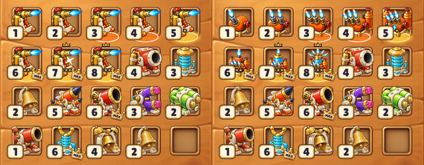

# In-game test: Blowtorch v2 on the real board

Made by `tools/ingame-preview.mjs`: boots the real game headlessly, swaps the Blowtorch textures at runtime (nothing in `src/` is touched), builds a board with the unit at ranks 1-8 among shipped units, screenshots at 390x844 (2x).

Left = the game today (one picture for every rank, plus the code decor). Right = Blowtorch v2, per-rank art.

Full board: `blowtorch_v2_ingame_board.png`.

## What the real board shows (harsh)
**Better than today, clearly**
- **Rank is readable at a glance.** Today all 8 cells show the same torch; with v2 the flames count up 1, 2, 3, then tanks appear, then the stacked tier and crown. This is the biggest gain of the whole program, and it is visible at real size.
- It sits in the game's world: bold outline, warm enamel, brass trim; the orange body and blue flames separate it from the red cannons and cyan coils.

**Problems only the real board shows**
1. **Ranks 6-8 are small.** The game fits every sprite into the same box by its visible height, so a tall rank 6-8 machine is scaled down; its body is about 60% of rank 5's. This is the same issue we could not fix by prompting (the model shrinks parts at rank 6); here it is amplified by the fit. Possible code fix at integration: one scale per unit (the rank 5 scale) so tall ranks stand taller.
2. **The code rank decor now competes with the art.** Today's `rankDecor` (floor ellipse, tiny stars, tiny crown, MAX crown badge) lands on top of art that is already ornate at ranks 6-8: the stars sit on the gauge area and make the cluster busier. If the art carries the rank, the decor should be reduced for units with per-rank pictures. (This is exactly what the `rank-looks` study is about.)
3. **Attention.** The blue flames are the brightest thing on the board; a Rare unit pulls the eye more than a Legendary-looking cannon next to it. Probably fine for the Blowtorch (it is a flame), but we must watch brightness as more units arrive: the loudest colours should belong to the most valuable units.
4. **The old art is more instantly "blowtorch" at rank 1**: a side view with a long horizontal flame. v2 rank 1 is a fat orange tank with an upward flame. Both read; the old one is a little clearer.

## Verdict in context
**7.5 / 10 at real board size.** The progression is a large improvement; the finish is consistent with the game; the top ranks are too small and too busy at 62-118 px.

## What this changes in the process
Every candidate ladder now gets this test before a score above 7.5 is allowed:
`node art-candidates/asset-program/tools/ingame-preview.mjs --family <id> --dir <slices folder>` (add `--mode today` for the before picture).
