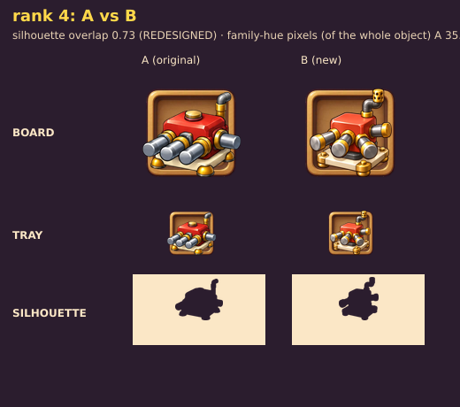
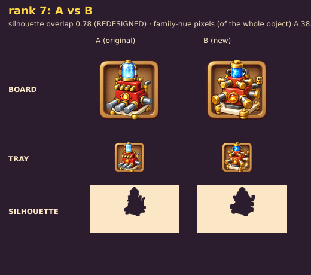

# Review: polish-pass test (Piston ranks 4 and 7)

Image: `../inbox/piston_polish_v1.png` · comparisons: `piston_polish_rank4_compare.png`, `piston_polish_rank7_compare.png`

## Verdict: the finish is the target look, but the polish pass does not preserve the design and barely helps at board size
Overall **7.5** (7.3 at board and tray size, 7.8 close-up). v3 was 7.2. Not 8.

## What happened
- **GPT redrew the machines instead of polishing them.** Silhouette overlap with the originals: rank 4 **0.73**, rank 7 **0.78** (below 0.85 = redesigned). Parts moved: the pistons now splay in different directions, rank 7 has pistons on both tiers with gold caps, the exhaust stack changed.
- The test criterion was "design kept (overlap 0.90 or more)". **It failed.** Applied rank by rank, a polish pass would break the ladder.
- **Good news inside the failure:** the splayed pistons fix flaw 1 of v3 (ranks 1-3 sharing an outline), and the finish is clearly better: bold dark outline, clean shading, no scratches, rounder shapes. This is the closest we have been to our anchors.

## Two readings of the same pictures
| | v3 original | polished | Why |
|---|---|---|---|
| Close-up (unit card 220 px, crate reveal) | 7.2 | **7.8** | Outline, shading and gloss clearly better; material 8.5. |
| Board and tray (118 and 62 px, where most of the game is) | 7.2 | **7.3** | At that size the finish is mostly lost; the polished machine is **smaller in the cell** (bigger plate with gold brackets), spikier and busier; the original's big grey pistons read stronger. |

Colour: family-hue pixels went **up**, 35.9% to 43.9% (rank 4) and 38.9% to 47.4% (rank 7), because GPT used a lighter orange-red close to `#d05a3a`; to the eye the gold caps and brackets still take more attention.

## Scores (polished pair, at board size)
Silhouette 7.0 · Material 7.0 · Style 7.5 · Colour 7.5 · Progression (two ranks, consistent with each other) 7.0 · Technical 9.0 → **7.3**. Close-up: Silhouette 7.5 · Material 8.5 · Style 8.0 · Colour 7.5 · Progression 7.0 · Technical 9.0 → **7.8**. Exposure-weighted (70% board, 30% cards): **7.5**.

## The 5 worst flaws
1. **Redesigned, not polished** (overlap 0.73 and 0.78).
2. **The machine shrank inside the cell**: the plate and brackets grew; at 64 px the body is small.
3. **Part count over budget** at rank 7 (about 20 parts, budget 12): busy at tray size.
4. **Gold overload**: gold caps on every piston, gold brackets, gold feet dilute the red body.
5. **The finish gain mostly disappears at the size the player sees most.**

## What we learn for the whole program
1. **Our real bottleneck at board size is mass, outline and value, not polish.** The Cannon anchors work because the shapes are huge and simple. Prompts must say: the machine fills the cell, the plate is only a little wider than the machine, few big parts.
2. **The polish language works** (bold 5% outline, one big highlight per part, no scratches, rounded corners). It moves into the first-pass sheet prompt (`../prompts/00_style_block.md` v3) instead of being a second pass.
3. **Splayed copies fix the outline problem**: "when a rank adds copies of a part, splay them in different directions" is now in the style block.
4. **A separate polish pass per rank is not worth its cost**; whole-sheet generation keeps ranks consistent.

## Next test
Use the improved template on a **new unit** (Blowtorch) as a first-pass sheet: `../prompts/05_blowtorch_v1.md`. If it scores 7.5 or more at board size on the first try, the template is adopted and the next units follow.
