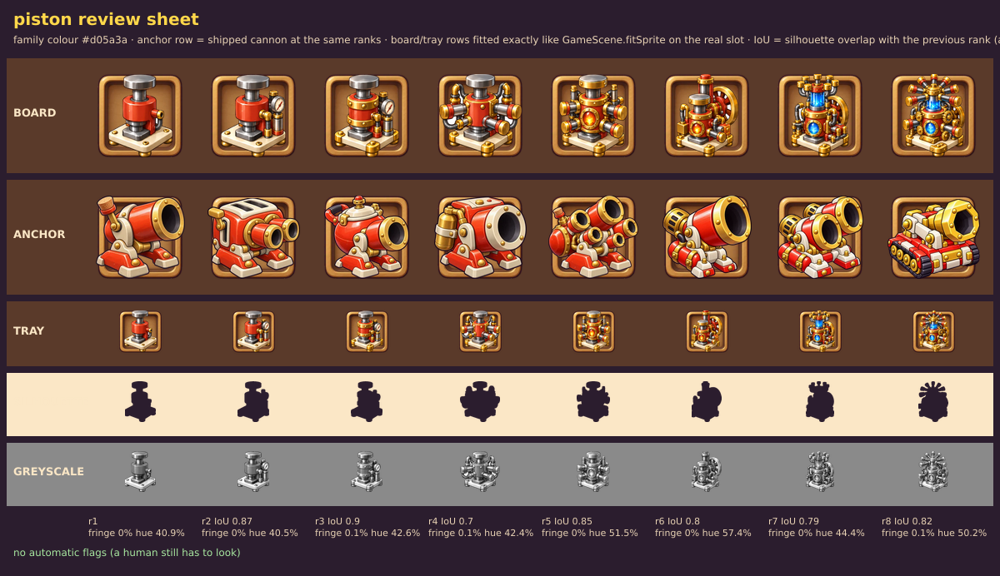

# Review: Piston ladder, GPT sheet v1 (round 1 of 3)

Sheet: `../inbox/piston_sheet_v1.png` · sliced: `../inbox/piston_v1/` · review sheet: `piston_v1_review_sheet.png`

## Verdict: **REDO** (absolute 6.5 / 10, ship bar 8)

Our shipped Cannon ladder scores 7.0 on the same scale, so this is below what we already have. The sheet is technically excellent and the materials are the best part, but it is the wrong machine and the ladder is not a clean progression. Both problems come from the plan I wrote, not only from GPT.

## What worked (keep it)
- **Format**: one shot, 8 cells, pure white background (254), no text, no aura, no floor shadows, nothing touching. The slicer cut it with 0 flags, fringe 0 to 0.1%.
- **Materials and light**: glossy red enamel, brass and steel read as different materials; highlights top-left; good value split (about 25% dark / 55% mid / 15-20% light). Rank 7 (blue crystal chamber) is the best single picture.
- **Early ranks 1 to 4** read as one machine growing (gauge, brass bands, four-piston cross).

## Scores

| Dimension | Weight | Score | Why |
|---|---|---|---|
| Silhouette and readability | 25% | **5.5** | Ranks 1-3 are almost the same black shape (overlap with the previous rank 0.87 and 0.90; greyscale row cannot tell them apart at 64 px). Rank 1 reads as a hydraulic press, which is another unit (blue Hydraulic Press, also a shooter). Rank 8 has a distinct sunburst outline but is full of detail. |
| Material and light | 20% | **7.5** | Convincing and glossy; a little too much hard specular on the steel. |
| Style match | 15% | **6.5** | Same universe (3/4 view, top-left light, rivets, cream plate) but the outline is about half the weight of the Cannon/Coil anchors and the metal is rendered more realistically; the plate has brass bun feet where the anchors have red feet. Looks like a second artist. |
| Colour | 10% | **6.5** | Tool: red-family pixels are 41-57% of the whole object at every rank (dark shaded red is not counted, so the real share is higher). To the eye, gold and steel take over from rank 5 and the machine stops reading as a red unit. |
| Rank progression | 20% | **5.5** | Not "previous plus one part": rank 5 drops the side pipes, rank 6 swaps the layout (tall rear cylinder and flywheel, the big side pistons are gone), rank 7 changes the top again. Rank 4 and 5 are both "cube with four big pistons". |
| Technical | 10% | **9.0** | Clean slice, no specks, nothing clipped. Background is 254, not pure 255, harmless. |
| **Weighted** | | **6.5** | No hard cap triggered (lowest overlap with previous rank is 0.70, none above 0.93). |

Per rank (absolute): r1 6.0 · r2 6.0 · r3 6.5 · r4 7.0 · r5 6.5 · r6 6.5 · **r7 7.5** · r8 6.5.

## The 5 worst flaws
1. **Wrong identity.** Ranks 1 to 3 are a vertical hydraulic press with a flat steel cap. `unit_hydraulic_press` already is that (blue, vertical, plate on columns), and the shipped `unit_piston` is a red block with horizontal rods. At 64 px a player would confuse Piston and Hydraulic Press.
2. **Ranks 1, 2 and 3 are indistinguishable at tray size.** Gauge and brass bands are inside the outline, not on it.
3. **The ladder is not additive.** Ranks 5, 6 and 7 each reshuffle the machine, so it stops being "the same machine growing".
4. **Style drift.** Thin outline and realistic metal next to our chunky painted anchors. Put on one board with the Cannon, it would look like a different game.
5. **Clutter and colour loss at the top.** Ranks 4, 5 and 8 turn into pipe mush at 62 px (rank 8 has about 25 parts; the budget was 12), and gold overtakes red from rank 5.

## What I got wrong in the prompt
- Rank 1 ("stubby cylinder with a flat piston head") invited a press. The roster and the shipped picture say: red block, short rods poking out.
- I let the rank axis be "whatever the next module is". A single counted axis (number of pistons, then tiers) is easier for GPT and easier for the player.
- I said "no brass" at rank 1 but did not forbid brass feet; I did not give outline thickness or a minimum share of red.

## Fix for round 2 (see `../prompts/02_piston_v2.md`)
New identity (red block with horizontal pistons, count is the main signal: 1, 2, 3, 4, then exhaust stacks, a second tier, a crystal tank, a crown manifold), outline and "painted not rendered" language, red at least 55% at every rank, 12-part budget, "add exactly one thing, never rearrange".

## Use of this sheet
Keep rank 7 as a reference for the crystal look. Do not import any of v1.
