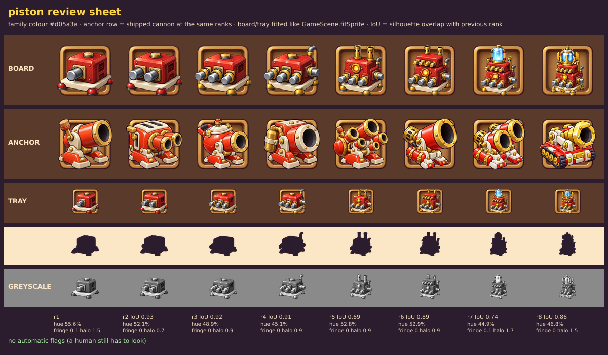

# Review: Piston ladder, GPT sheet v2 (round 2 of 3)

Sheet: `../inbox/piston_sheet_v2.png` · sliced: `../inbox/piston_v2/` · review sheet: `piston_v2_review_sheet.png`

## Verdict: **REDO, one targeted last round** (absolute **7.0** / 10, ship bar 8). Up from 6.5.

The identity is fixed and the ladder finally reads as one machine growing. What holds it back is the outline of ranks 1 to 4 and a style that is still a notch too busy and boxy next to our anchors.

## What improved since v1
- **Identity**: clearly a Piston now (red block, grey horizontal pistons). No longer confusable with the Hydraulic Press.
- **Additive ladder**: pistons 1, 2, 3, 4, then exhaust stacks and a window, a second tier, a crystal tank, a crown manifold. A stranger can put the ranks in order.
- **Colour**: red is the main colour in all 8 cells; brass stays trim.
- **Top ranks**: 7 (crystal tank) and 8 (gold crown, fins, ornate plate) have real hero feel and the outline finally changes (overlap with previous rank 0.74 and 0.86).

## Scores

| Dimension | Weight | v1 | **v2** | Why |
|---|---|---|---|---|
| Silhouette and readability | 25% | 5.5 | **6.0** | Distinct machine, strong top ranks, but ranks 1-4 are almost the same black shape (overlap 0.93, 0.92, 0.91): the extra pistons sit inside the body's footprint. Tray and greyscale rows cannot tell ranks 2, 3, 4 apart. |
| Material and light | 20% | 7.5 | **7.0** | Glossy and clear, but "worn metal" scratches and many tiny rivets appear from rank 5. |
| Style match | 15% | 6.5 | **6.5** | Closer in colour and chunkiness, still boxy with sharp edges and engraved details (panel screws, vents) where the anchors are round and simple; outline thin. |
| Colour | 10% | 6.5 | **7.5** | Red dominant everywhere, tasteful brass, a good blue crystal accent. Body red is a deeper crimson than the family colour `#d05a3a` and close to Cannon's red. |
| Rank progression | 20% | 5.5 | **7.5** | Additive and monotone. Minus: rank 5's body is taller than rank 4's (rank 4 to 5 overlap 0.69), so the machine is not exactly the same one. |
| Technical | 10% | 9.0 | **9.0** | After clean-up. Raw slice scored 7: GPT drew a faint grey floor shadow under the plate despite "no floor shadows" (see tool changes). |
| **Weighted** | | 6.5 | **7.0** | No hard cap, but ranks 1-4 sit right at the 0.93 line. |

Per rank: r1 6.5 · r2 6.5 · r3 6.5 · r4 6.5 · r5 7.0 · r6 7.0 · **r7 7.5 · r8 7.5**.

## The 5 worst flaws
1. **Ranks 1 to 4 do not change the outline** (0.93, 0.92, 0.91). The player will not tell rank 2 from 3 on the board.
2. **Rank 5's body is taller and deeper than rank 4's**; the top button and side vent vanish. Not "the same machine".
3. **Style**: boxy, sharp-edged, engraved details and scratches; outline about half the anchors' weight. Next to the Cannon it still looks like another artist.
4. **Grey contact shadow** under the plate in all cells (light, jagged edge; invisible on white, visible as a pale strip on the dark slot).
5. **Rank 6's second-tier pistons are tiny and brass** (the first tier's are big and steel), so rank 6 reads as "decoration", not "more pistons".

## Tool changes this round (found on this sheet)
- `slice-sheet.mjs` now treats light neutral grey connected to the white background as background, so floor shadows go while the dark outline protects the object (`--no-shadow-clean` turns it off). Checked at 3x on the dark slot: strip gone, object untouched.
- `review-sheet.mjs` has a new **grey halo** metric and flag (light neutral pixels in the outer 5 px band): v1 0.3-2%, raw v2 7.6-10.5%, cleaned v2 0.7-1.7%. The old fringe metric missed this defect.

## Round 3 (last): `../prompts/03_piston_v3.md`
Keep identity, ladder and ranks 5-8; make pistons long and fan out so ranks 1-4 sprout spikes, freeze the body size through rank 5, simplify the style (no screws, vents, scratches; thicker outline), forbid the grey shadow.
If round 3 is still below 7.5, we do not do a 4th wording round: we change the concept (for example one big dominant weapon per rank instead of a piston count).
