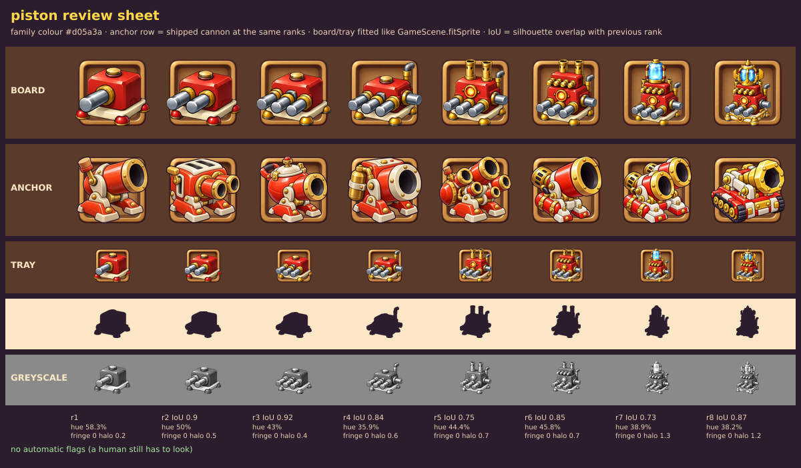

# Review: Piston ladder, GPT sheet v3 (round 3 of 3, last)

Sheet: `../inbox/piston_sheet_v3.png` · sliced: `../inbox/piston_v3/` · review sheet: `piston_v3_review_sheet.png`

## Verdict: **7.2 / 10. Good, but NOT ship quality** (units need 8). Round budget is used up, so wording stops here.

| Round | Absolute | What moved it |
|---|---|---|
| v1 | 6.5 | wrong machine (a press), non-additive ladder |
| v2 | 7.0 | **new concept** (counted pistons, red block): +0.5 |
| v3 | 7.2 | **wording only** (5 fixes): +0.2 |

Lesson: a changed plan buys half a point, a reworded prompt buys a fifth. Further wording rounds will not get us to 8.

## The five fixes I asked for, and what GPT did
| Fix | Result |
|---|---|
| 1. Ranks 1-4 must change the outline, pistons fan out | **Half.** Pistons are longer and rank 4 now has a high steam pipe (overlap with rank 3 is 0.84), but the pistons run parallel instead of fanning, so ranks 2 and 3 are still 0.90 / 0.92. |
| 2. Body identical through rank 5; big steel pistons on rank 6 | **No.** Rank 5's body is again a taller block (overlap with rank 4 is 0.75) and rank 6's new pistons are still tiny and brass. |
| 3. Simpler, chunkier style, thicker outline | **Mostly for ranks 1-4** (smooth, rounded, glossy, clean: the best-looking cells so far). Ranks 5-8 keep scratches and engraved lines, so one ladder shows two finishes. Outline is a bit heavier, not twice. |
| 4. No grey floor shadow | **Yes.** Grey-halo metric 0.2-1.3% (v2 raw was 7.6-10.5%). |
| 5. Keep ranks 5-8 | Kept, with the same flaws. |

## Scores

| Dimension | Weight | v1 | v2 | **v3** | Why |
|---|---|---|---|---|---|
| Silhouette and readability | 25% | 5.5 | 6.0 | **6.5** | Ranks 4-8 clearly different outlines; 1-3 still one blob; at tray size ranks 1-3 look like a small cannon. |
| Material and light | 20% | 7.5 | 7.0 | **7.5** | Ranks 1-4 are clean and painterly now; 5-8 still scratchy. |
| Style match | 15% | 6.5 | 6.5 | **7.0** | Rounder and chunkier; outline still lighter than the Cannon anchors. |
| Colour | 10% | 6.5 | 7.5 | **7.5** | Red main in all cells; at ranks 7-8 gold and crystal take more of the eye (red 38-39% of saturated pixels). |
| Rank progression | 20% | 5.5 | 7.5 | **7.0** | Additive overall, but rank 5's taller body and rank 6's tiny pistons break "same machine, one new thing". |
| Technical | 10% | 9.0 | 9.0 | **9.0** | Clean slices, no halo. |
| **Weighted** | | 6.5 | 7.0 | **7.2** | |

Per rank: r1 7.0 · r2 7.0 · r3 7.0 · **r4 7.5** · r5 7.0 · r6 6.5 · **r7 7.5 · r8 7.5**.

## The 5 worst flaws
1. Ranks 2 and 3 are still almost the same outline (0.90, 0.92): parallel pistons, no fan.
2. Rank 5's body jumps in height and loses the top button, so rank 4 to 5 is not the same machine.
3. Rank 6's second tier has four tiny brass pistons that read as ornament, not as more pistons.
4. Two finishes in one ladder: clean toy-like ranks 1-4, scratchy engraved ranks 5-8.
5. Outline still lighter than our anchors, and ranks 1-3 look like a small cannon at tray size (red body, one big barrel).

## What is good enough to keep
Ranks 4, 7 and 8 are strong. Ranks 1-4 show the finish we want for the whole ladder. The identity and the counted-pistons axis are right. Nothing from v1.

## Process decision
Stop iterating the sheet prompt. Test a **polish pass**: take single ranks from the sheet and ask GPT to redraw the same machine with a bolder outline and clean shading, keeping parts and silhouette (`../prompts/04_polish_test.md`). If a polished rank scores 8 or more and keeps the design (silhouette overlap with the original at least 0.9), the pipeline becomes two stages: sheet for design (about 7), polish per rank (target 8). If not, we know the ceiling and plan hand repair or an illustrator for the last point.
